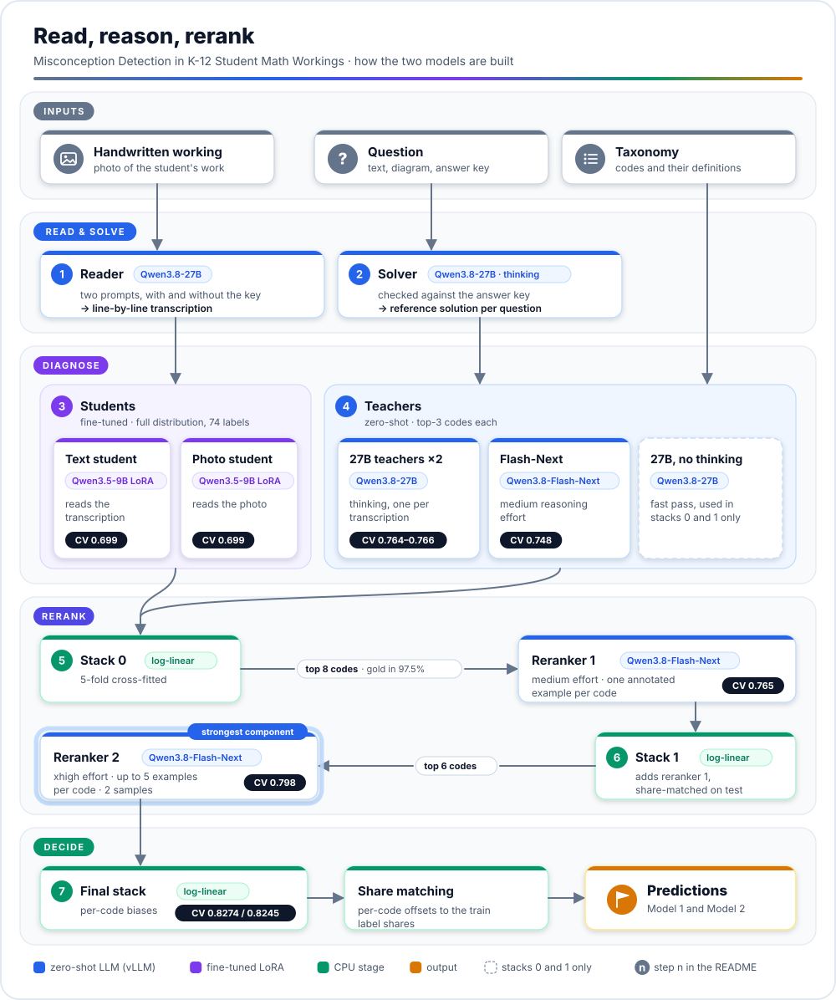

# Misconception Detection in K-12 Student Math Workings — solution

Two models were developed for this competition, and this repository rebuilds both, from the photos of the students' workings
to one prediction file per model. The approach is summarised first; the rest of this README explains how to run it. Results,
ablations and lessons are in [WRITEUP.md](WRITEUP.md).

## Approach



*The numbers mark the steps below, and the legend explains the colours. Arrows show the main flow; the students and teachers also
see the question, and each stack uses the model outputs before it (the no-thinking 27B teacher only in the first two).*

**Terms used below.** *Code:* a misconception from the competition's taxonomy; there are 74 labels, NONE (no misconception) and
the 73 codes that occur in the training data. *CV:* the competition metric, MAP@3, measured by 5-fold cross-validation on the
1,487 training rows that can be scored (the 13 rows whose code occurs only once always stay in training). *Stack:* a small model
fitted on the training labels that weighs and combines model outputs. *Share matching:* an adjustment that makes each code about
as frequent in the test predictions as it is in train.

1. **Read.** Qwen3.8-27B transcribes each handwritten working line by line, once with the answer key in view and once without:
   with the key in view, the reader sometimes "corrected" wrong answers toward it.
2. **Solve.** The same model solves every question with thinking on, up to six tries, and keeps the first solution whose final
   answer matches the key; the 15% of questions without a match keep their first attempt.
3. **Students (fine-tuned).** Two Qwen3.5-9B LoRA models, one reading the transcription and one the photo, compute the
   probability of every label's text, so each gives a full distribution over the 74 labels (CV 0.699 each).
4. **Teachers (zero-shot).** Qwen3.8-27B with thinking, once per transcription, and Qwen3.8-Flash-Next at medium effort name
   their three best codes from the photo, the transcription, the solution and the full taxonomy (CV 0.764–0.766 and 0.748). A
   fourth, fast 27B pass without thinking is used in the first two stacks only.
5. **Rerank, round 1.** A first stack of these outputs proposes 8 candidate codes per row (the gold code is among them on 97.5%
   of training rows). Flash-Next ranks them, seeing each code's definition, the annotation conventions that mention it and
   one annotated example.
6. **Rerank, round 2.** A second stack, which adds round 1 and is share-matched over the test set, narrows the list to 6.
   Flash-Next ranks again at its highest reasoning effort (xhigh), with up to five examples per code and two samples. This is the
   strongest single component (CV 0.798).
7. **Final stack and share matching.** A last stack combines the students, the teachers and both rerankers, with a learned bias
   for each code that has enough training rows. Share matching then shifts each code's predicted share over the test set to its
   share in train, and the top three codes of each row are the prediction.

Every model output used to fit the stacks is out-of-fold, so CV is never measured on rows a model learned from.

## The two models

| model | output file | CV | public score | Kaggle entry |
|---|---|---|---|---|
| **Model 1** | `outputs/predictions_58446106.csv` | 0.8274 | 0.83050 | 58446106 |
| **Model 2** | `outputs/predictions_58446518.csv` | 0.8245 | 0.83033 | 58446518 |

The two models share every component and every model output, and one run builds both. They differ only in two settings of the
last step (`FINALS` in `scripts/stages.sh`):

| setting | Model 1 | Model 2 |
|---|---|---|
| per-code biases: the final stack learns its own bias for each code with at least N training rows | N = 25 (13 codes) | N = 40 (7 codes) |
| share matching: labels with at least M training rows get their own shift, the rarer ones share one | M = 5 (51 of 74 labels) | M = 2 (61 of 74 labels) |

In both models NOT-01 (imprecise notation that does not change the answer) always gets its own shift: it is the root of only one
training row, yet the final stack ranks it second or third on about a fifth of the scored rows.

## Ways to run it

| path | what it does | what is needed | command | time on 4 × L40S |
|---|---|---|---|---|
| **(a)** | predicts with both models from the trained weights | setup 1–4 | `./run_inference.sh` | about 100 GPU-hours (25–30 h) |
| **(b)** | trains everything from scratch, then predicts with both models | setup 1–3, in a clean checkout | `./run_training.sh` | an estimated 150 GPU-hours |
| **(c)** | rebuilds both prediction files exactly from saved outputs, without GPUs | `.venv-train` (setup 1), the data (setup 2), archives 1 and 2 (setup 4) | `CPU_ONLY=1 ./run_inference.sh` | about a minute |
| **(d)** | refits the five stack fits from saved outputs, then rebuilds both prediction files, without GPUs | `.venv-train`, the data, archives 2 and 3 (not 1), in a clean checkout | `CPU_ONLY=1 ./run_training.sh` | about a minute |

Path (a) is the main reproduction check; setup 1 to 5 below prepare it. Path (d) also prints each stack's cross-validated score
(the `CROSS-FITTED` lines): 0.8274 for Model 1 and 0.8245 for Model 2. To predict another test set, such as a private one, see
"Running on a new test set".

Where the time goes:

- **(a):** mostly the second-round reranker (about 23 GPU-hours per sample, two samples) and the two 27B thinking teachers (about
  30 GPU-hours).
- **(b):** path (a), plus the same stages on the training rows (an estimated 40 GPU-hours, from their row counts) and the ten
  student folds (about 47 minutes each on one GPU).

## How the scripts work

The pipeline is a fixed list of stages (see "Pipeline at a glance" at the end). `run_inference.sh` and `run_training.sh` call
them in order:

- **Model stages** run the language models with vLLM on the GPUs and write their answers to files.
- **CPU stages** combine those answers in the stacks and write the prediction files.
- **A stage is skipped when its output files already exist.** A stopped run therefore continues where it stopped when the same
  command is run again, and saved outputs (archives 2 and 3) can stand in for the model stages. Before any stage, the scripts
  check that the test-side outputs present belong to the current `data/raw/test.csv` ("Running on a new test set").

Every stage command is written once, in `scripts/stages.sh`.

## Setup 1 — Hardware and software

**Hardware used to build the models:**

- GPUs: 4 × NVIDIA L40S (48 GB each)
- CPU and RAM: Xeon Silver 4510 (32 cores), 125 GB
- OS and driver: Ubuntu 22.04, NVIDIA driver 580.105.08

Notes:

- The largest model, Qwen3.8-Flash-Next, is split across all four GPUs and needs about 40 GB of system RAM while it loads.
- Every other stage needs one GPU (student training peaks at about 24 GB), and the scripts run up to four of them at once.

**Software:** Python 3.12.13 with the CUDA 13.0 PyTorch wheels (`torch 2.13.0+cu130`). Two Python environments are needed,
because vLLM and the training code need different `transformers` versions:

| environment | package list | main packages | used for |
|---|---|---|---|
| `.venv-vllm` | `requirements/vllm.txt` | vLLM 0.31.0, transformers 5.17.0 | every model stage except the students |
| `.venv-train` | `requirements/train.txt` | transformers 5.20.0, peft 0.21.2, scikit-learn 1.9.1 | the students, the stacks and the CPU tools |

```bash
IDX="--index-strategy unsafe-best-match --extra-index-url https://download.pytorch.org/whl/cu130"
uv venv --python 3.12 .venv-vllm
uv pip install --python .venv-vllm/bin/python $IDX -r requirements/vllm.txt
uv venv --python 3.12 .venv-train
uv pip install --python .venv-train/bin/python $IDX -r requirements/train.txt
```

The environments can live elsewhere: set `VENV_VLLM` and `VENV_TRAIN` to their `python` executables.

**Compiler:** when vLLM starts, FlashInfer compiles a few GPU kernels. This needs a CUDA 13 toolkit (`nvcc` on `PATH`, or
`CUDA_HOME` set) and a C++ compiler; the original run used the CUDA toolkit 13.3 and g++ 11.4. It also needs `ninja` from the
vLLM environment, which the run scripts put on `PATH`. The first start is slower while the kernels are built; later starts reuse
them.

## Setup 2 — Data

Download the competition files with the Kaggle API, copy them into `data/` and check them:

```bash
.venv-train/bin/kaggle competitions download -c misconception-detection-in-k-12-student-math-workings -p download
unzip -q download/misconception-detection-in-k-12-student-math-workings.zip -d download
mkdir -p data/raw
cp download/train.csv download/test.csv download/unlabelled.csv data/raw/
cp download/competition_data/sample_submission.csv download/competition_data/taxonomy_v1.csv data/raw/
mv download/competition_data/images data/images
# check the layout, then write data/labels.json and data/folds.csv
PYTHONPATH=src .venv-train/bin/python scripts/prepare_data.py
```

Two things to watch:

- **Use the CSVs at the top level of the download.** The download holds two copies of `train.csv`, `test.csv` and
  `unlabelled.csv`. The top-level copies have English topic names, and the pipeline was built on them. The copies under
  `competition_data/` have Indonesian topic names; the topic name is part of every prompt, so they would change the model inputs,
  and `prepare_data.py` refuses them. (`sample_submission.csv`, `taxonomy_v1.csv` and the images exist only under
  `competition_data/`.)
- **Keep the images inside `data/`.** vLLM only loads an image whose real path, after following symlinks, is inside `data/`. A
  symlinked `data/` folder is fine; a `data/images` link that points to another disk is not, and `prepare_data.py` checks this.

Expected layout:

```
data/raw/{train,test,unlabelled,taxonomy_v1,sample_submission}.csv
data/images/{train,test,unlabelled,questions}/
data/labels.json, data/folds.csv               written by prepare_data.py
```

| file | md5 |
|---|---|
| `data/raw/train.csv` | `479a22f147780db36658a62b43359688` |
| `data/raw/test.csv` | `2b3e8bd5857373609a16dbfb3bb00e09` |
| `data/raw/unlabelled.csv` | `60fbf2d09e80523c013e0fc29cb40b7f` |
| `data/raw/sample_submission.csv` | `89a0f1dd2658f449fd543ecfd9ef988d` |
| `data/raw/taxonomy_v1.csv` | `6d79a68b850df0bd17b64655b097a611` |

The working copies used during the competition had one extra column (`topic_name_id`) that no code reads; the Kaggle files above
were checked to give identical prompts and identical `labels.json` and `folds.csv`. This repository holds no competition data,
transcription, prediction or weight.

## Setup 3 — Models

Download the three base models from Hugging Face and point the scripts to them with three variables:

| variable | model | licence |
|---|---|---|
| `M9` | [Qwen/Qwen3.5-9B](https://huggingface.co/Qwen/Qwen3.5-9B) | Apache-2.0 |
| `M27` | [Qwen/Qwen3.8-27B](https://huggingface.co/Qwen/Qwen3.8-27B) | Apache-2.0 |
| `MFN` | [nvidia/Qwen3.8-Flash-Next-NVFP4](https://huggingface.co/nvidia/Qwen3.8-Flash-Next-NVFP4) | NVIDIA Open Model License (base model: Qwen Community License 1.0) |

```bash
HF=.venv-train/bin/hf
$HF download Qwen/Qwen3.5-9B --revision c202236235762e1c871ad0ccb60c8ee5ba337b9a --local-dir /models/Qwen3.5-9B
$HF download Qwen/Qwen3.8-27B --revision 37561816e66b5b9153b1b64c10968c18c1e6f4a0 --local-dir /models/Qwen3.8-27B
$HF download nvidia/Qwen3.8-Flash-Next-NVFP4 --revision fc694b54fb0174e0913e6adf86691ef85a4ead47 --local-dir /models/Qwen3.8-Flash-Next-NVFP4
export M9=/models/Qwen3.5-9B M27=/models/Qwen3.8-27B MFN=/models/Qwen3.8-Flash-Next-NVFP4
```

The revisions pin the exact model versions of the original run; at these revisions the configuration, the tokenizer
configuration and the chat template are byte-identical to the original copies. vLLM quantises the 27B model to FP8 when it loads
it. No API or closed model is called anywhere. The exact settings of every model stage are under "Model settings" at the end.

## Setup 4 — Trained artefacts

Trained weights and transcriptions may not be published (competition rules), so the trained artefacts and the saved model
outputs come as three archives through private download links, sent separately. Unpack each one at the repository root:

```bash
tar -xzf <archive> -C .
```

**Archive 1 — trained artefacts**, needed for paths (a) and (c):

| path | content |
|---|---|
| `runs/t9gen_zs_v1/fold{0..4}/`, `runs/v9gen_img_v1/fold{0..4}/` | the two students' LoRA adapters (`adapter/`) and training arguments (`args.json`), one per fold |
| `fits/round0.npz`, `fits/round1.npz`, `fits/round1_matched.npz` | stack 0 (`round0`) and stack 1 (`round1`, `round1_matched`), which choose the two rerankers' candidate lists |
| `fits/final_58446106.npz`, `fits/final_58446518.npz` | the final stacks of Model 1 and Model 2 |

**Archive 2 — saved stage outputs**, needed for paths (c) and (d). It holds the test-side output of every model stage of the
original run:

| path | content |
|---|---|
| `data/trans/zs27v2_test.csv`, `data/trans/zs27v3q_test.csv` | the two transcriptions |
| `data/solutions/q27_think_n2.csv`, `data/solutions/q27_think_v2.csv` | the reference solutions |
| `runs/t9gen_zs_v1/fold{0..4}/test_probs.npy`, `runs/v9gen_img_v1/fold{0..4}/test_probs.npy` | the students' test predictions |
| `runs/{zsnt_pred_v1,zst_pred_v1,zst_v3q_test,d_fnext_test,rrfn_test}/test.npy`, `runs/rr2x5{,_s1}_test/rank.npy` | the teachers' and rerankers' test outputs |
| `reference/top8_cands.csv`, `reference/top6_cands.csv` | the two original candidate lists, to compare with the rebuilt ones |

**Archive 3 — saved training-side outputs**, needed only for path (d). It holds the training-side output of every model stage of
the original run:

| path | content |
|---|---|
| `data/trans/zs27v2_train.csv`, `data/trans/zs27v3q_train.csv` | the two transcriptions of the training rows |
| `runs/t9gen_zs_v1/fold{0..4}/val_{probs,rows}.npy`, `runs/v9gen_img_v1/fold{0..4}/val_{probs,rows}.npy` | the students' out-of-fold predictions |
| `runs/{zsnt_pred_v1,zst_train_v1,zst_v3q_all,d_fnext_all}/oof{,_partial}.npy`, `runs/rrfn_all/oof_partial.npy`, `runs/rr2x5{,_s1}_all/rank.npy` | the teachers' and rerankers' out-of-fold outputs |

Path (d) runs `run_training.sh`, which refuses a checkout that holds archive 1 (it would treat the shipped fits as its own), so
unpack archives 2 and 3 in a clean checkout. The original candidate lists sit in `reference/`, not in `data/rerank/`, because the
CPU stages rebuild them there. `predict_vlm_gen.py` loads the base model from `M9`, not from the path recorded in `args.json`.

## Setup 5 — Commands

Run every command from the repository root. Paths (a) and (b) need the three model variables from setup 3; paths (c) and (d) need
none.

**(a) Inference from the trained weights** (about 100 GPU-hours):

```bash
export M9=/models/Qwen3.5-9B M27=/models/Qwen3.8-27B MFN=/models/Qwen3.8-Flash-Next-NVFP4
./run_inference.sh          # -> outputs/predictions_58446106.csv (Model 1), outputs/predictions_58446518.csv (Model 2)
```
Before any model starts, the script checks the data and the trained artefacts and lists anything missing.

**(b) Full training from scratch** (an estimated 150 GPU-hours), in a clean checkout without the trained artefacts:

```bash
./run_training.sh           # same variables; writes fits/ and the adapters, then both prediction files
```
The script refuses a checkout that already holds `fits/` or student adapters it did not produce itself; otherwise it would
silently reuse them.

**(c) Exact rebuild from the saved stage outputs** (a few minutes, no GPU and no model):

```bash
tar -xzf <trained artefacts archive> -C . && tar -xzf <stage outputs archive> -C .
CPU_ONLY=1 ./run_inference.sh
```
Every model stage finds its saved outputs and is skipped, so only the CPU stages run. `CPU_ONLY=1` stops the run, naming the
stage, if a model stage would have to start. On the original machine this rebuilt both prediction files byte for byte:

- `outputs/predictions_58446106.csv` (Model 1): md5 `60568fa8401d1adc55f7d77720a1f43c`
- `outputs/predictions_58446518.csv` (Model 2): md5 `014fd5947a7491257b88801aa44333ed`

If the md5s differ, compare the rebuilt candidate lists `data/rerank/top8_cands.csv` and `top6_cands.csv` with the originals in
`reference/` first, then see "CPU threads" under "Seeds and how close a rerun gets".

## Running the scripts

- **Stop and resume:** Ctrl-C, or `kill <driver pid>`, stops every running stage, including the vLLM processes. Running the same
  command again continues where it stopped: finished stages are skipped, and the model stages resume shard by shard.
- **Stalls:** a watchdog restarts a stalled Flash-Next pass.
- **Logs:** model stages write their logs to `logs/`; the CPU stages print to the terminal.
- **Checks at start:** the folders in `M9`, `M27` and `MFN` are checked before anything runs, and each model stage names the
  variable it needs.
- **Dry run:** `DRY=1 ./run_inference.sh` prints every command without running it.
- **Smoke run:** `ROWS=ids.csv ./run_inference.sh` (a CSV with a `trace_id` column) runs the first test-side model stages (reader,
  solutions, students, teachers) on those rows only, then stops, because the candidate lists need every test row. Run it in a
  separate copy of the repository: a full run refuses a checkout that holds smoke-run outputs (marked by `.rows_run`).
- **Other GPUs:** `GPUS="0 1"` selects the cards to use. Flash-Next is then split across those cards, which must hold it.
- **Paths:** keep the repository and model paths free of spaces; the job commands are built as shell strings.

## Running on a new test set

The trained models can predict any set of workings in the competition's format, for example a private test set:

1. Start from a fresh checkout with archive 1 only (setup 4). Archive 2 holds outputs of the competition's test set; archive 3 is
   not needed.
2. Put the competition files in place as in setup 2, then replace `data/raw/test.csv` with the new set and the contents of
   `data/images/test/` with its photos. Keep the other files: the training rows supply the label list and the rerankers'
   examples, and `sample_submission.csv` gives the output columns.
3. Run `./run_inference.sh` (path (a)). Each prediction file then has one row per row of the new `test.csv`.

The new `test.csv` needs the columns of the competition's top-level `test.csv` (`trace_id`, `question_id`, `grade`,
`topic_name`, `question_text`, `question_image_file`, `correct_answer`, `image_file`, `topic_name_id`), unique `trace_id`s and
English topic names. New questions and topics are fine: the solver solves every question that appears in the CSVs, and a
question's diagram goes into `data/images/questions/` (an empty `question_image_file` means no diagram).

- **Outputs of another test set are refused.** A stage is skipped when its output exists, so before any stage the drivers
  compare `data/raw/test.csv` with the test set that the checkout's test-side outputs belong to (recorded in `.test_set`;
  outputs without that record are taken to be the competition's). If they differ, the run stops and lists those files; nothing
  is deleted.
- **Labels:** only the 74 labels seen in training can be predicted.
- **Batch steps:** share matching and reranker 2's candidate lists treat the test set as a batch and pull each code's predicted
  share toward its share in train. They assume a test set large enough, and with a code mix close enough to train's, for those
  shares to fit; on a small set or a different mix they still run, but may fit less well.
- **Time:** the model stages scale with the number of rows (about 100 GPU-hours for the 3,498 competition rows, roughly 1.7
  GPU-minutes per row), plus the solver, which solves every question in the CSVs again (about 50 minutes on one GPU).
- **Checked:** `run_inference.sh` ran end to end, every stage, in 93 minutes on 4 × L40S, on a 10-row test set built from
  unlabelled rows under new `trace_id`s, with an unseen question, an unseen topic and three questions without a diagram, from a
  fresh clone with archive 1 only. Both prediction files had one valid row per test row, and the solver covered the unseen
  question. A full-size private test set has not been run.

## Troubleshooting

| message (beginning) | meaning | fix |
|---|---|---|
| `missing competition files`, `... holds no image files` | a CSV or an image folder is not in place | setup 2 |
| `... these are the copies with Indonesian topic names` | the CSVs from `competition_data/` were copied | copy the top-level CSVs instead (setup 2) |
| `data/images/... resolves to ..., outside data/` | `data/images` is a link to another disk | move the images inside `data/`, or link `data/` itself (setup 2) |
| `error: M27=... is not a directory` (or `M9`, `MFN`) | a model variable points to the wrong folder | fix the path (setup 3) |
| `error: the ... stage needs M27` (or `M9`, `MFN`) | a model stage has to run and its variable is not set | set the variable (setup 3) |
| `missing trained artefacts` | archive 1 is not unpacked | unpack it at the repository root (setup 4) |
| `error: CPU_ONLY=1, but the ... stage has to run` | a saved output for path (c) or (d) is missing | unpack archive 2, and archive 3 for path (d) (setup 4) |
| `error: the test-side outputs below were computed for another test set` | `data/raw/test.csv` changed after a run, or archive 2 sits next to a new test set | start from a fresh checkout with archive 1 only, or move the listed files away ("Running on a new test set") |
| `error: this checkout already holds trained artefacts` | path (b) was started in a checkout that holds archive 1 | train in a clean checkout |
| `error: this checkout holds the outputs of a ROWS smoke run` | smoke-run outputs are in this checkout | run full paths in a fresh checkout |
| `error: a GPU job failed`, `error: ... failed (log: ...)` | a model stage crashed | read that stage's log in `logs/`, then run the same command again |
| `No such file or directory: 'ninja'` | vLLM was started outside the run scripts | start stages through the run scripts, or put the vLLM environment's `bin/` on `PATH` |

## Seeds and how close a rerun gets

- **Seeds:** folds `StratifiedKFold` on `root_code`, seed 42; students seed 0; teachers, solver and first reranker vLLM seed 0
  per request; second reranker seeds 0 and 1 (its two samples); the reader is greedy.
- **Sampling:** the model stages sample (temperature 0.6 for the two 27B thinking teachers and the solver, 1.0 for Flash-Next; the
  reader and the no-thinking teacher are greedy), and vLLM output also changes with batching, restarts and GPU type. A rerun
  therefore repeats the procedure, not the exact tokens. On the same GPU type, the students' predictions from the saved adapters
  are bit-identical between runs; their fine-tuning is not bit-reproducible on GPU, even with the same seed.
- **Expected result:** a full rerun is expected within about 0.01 MAP@3 of the original scores, more likely below than above,
  because the saved samples look like a favourable draw.

| measurement | result |
|---|---|
| CPU stages from the saved stage outputs, paths (c) and (d) | both files byte for byte; the five stack fits array-identical |
| 300 test rows re-run from the photos through every stage, an earlier version of the final stack (Kaggle entry 58413133: no-thinking teacher still in, standard share matching) | same first code as the saved file on 92% of those rows |
| two production files that differ by one reranker sample | same first code on 96% of rows |
| redrawing one stage | cross-validated score moves by about 0.001 for a reranker sample and drops by 0.006–0.009 for a Flash-Next teacher sample |

The 300-row measurement was not repeated on the two final stacks.

- **CPU threads:** the CPU stages are deterministic given their inputs, with one detail: OpenBLAS adds numbers in an order that
  depends on the number of threads, so fitted weights can differ in the last digits. The scripts use the thread counts of the
  original run (32 for the candidate stacks, 2 for the final stacks), which reproduce every intermediate file bit for bit. Other
  thread counts change the weights in about the sixth decimal, which in the checks changed no ranking and neither prediction
  file.
- **Static text:** the two convention sheets in `conventions/` are short rule lists written once during development.
  `sheet_folds234.txt` was written from the taxonomy and the annotators' notes of folds 2–4; it is shown to training rows of
  folds 0–1 and to the test set. `sheet_folds01.txt` is that list re-checked against the notes and statistics of folds 0–1 alone
  (rules kept only where those folds support them, the others revised or dropped); it is shown to training rows of folds 2–4.
  The code pairs the rules cover still come from folds 2–4, a small residual overlap. No script produces the sheets.

**What was and was not rerun.** The two models were built stage by stage with these same commands, as separate jobs. The
shipped code was then cleaned up (comments, unused experiment options) and the two run scripts were written. Both were checked
against the original code:

- every vLLM stage sends the same requests, prompts and sampling settings and writes the same files (checked with a stand-in for
  vLLM, on all rows);
- the two students build identical inputs on every training and test row, their predictions from the saved adapters are
  bit-identical to those of the original code, and a 15-step training run of the photo student stays within the spread of two
  original runs with the same seed;
- with the saved stage outputs, both scripts skip every model stage and rebuild their CPU outputs bit for bit: the five stack fits
  (`run_training.sh`), both candidate lists and both prediction files (paths (c) and (d), from fresh clones with the archives);
- a real-model smoke run on 6 test rows went through every stage of `run_inference.sh`, including a stop and a resume;
- `run_inference.sh` ran end to end on a 10-row synthetic test set from a fresh clone with archive 1 only ("Running on a new
  test set").

Neither script has been run end to end on the full data, and the full student fine-tuning was not rerun.

## Reference

### Model settings

All values come from `scripts/stages.sh` and the scripts' defaults.

| stage | model | settings |
|---|---|---|
| reader | Qwen3.8-27B, FP8 | greedy; two prompts, with and without the answer key; context 6,144 tokens |
| reference solutions | Qwen3.8-27B, FP8, thinking | temperature 0.6, top-p 0.95; the first solution whose final answer matches the key, else the first attempt; 2 tries, then up to 4 more for questions still unmatched |
| students | Qwen3.5-9B, bf16 | LoRA r 16, alpha 32, dropout 0.05 on the language model's attention and MLP projections (vision tower frozen); lr 2e-4, 3 epochs, gradient accumulation 8, seed 0; images up to 1,048,576 pixels; auxiliary targets at weight 0.3: final-answer correctness (both) and the transcription (photo student); one model per fold, test = mean of the five |
| 27B teachers | Qwen3.8-27B, FP8, FP8 KV cache, thinking | temperature 0.6, 6,144 new tokens, seed 0; top 3 codes |
| no-thinking teacher | Qwen3.8-27B, FP8 | greedy, 1,024 new tokens; stacks 0 and 1 only |
| Flash-Next teacher | Qwen3.8-Flash-Next-NVFP4, tensor-parallel | medium reasoning effort, temperature 1.0, top-k 20, 12,288 new tokens, seed 0 |
| first reranker | Qwen3.8-Flash-Next-NVFP4 | medium effort; the top 8 of stack 0, one annotated example per code; 4,096 new tokens, seed 0 |
| second reranker | Qwen3.8-Flash-Next-NVFP4 | xhigh effort; the top 6 of stack 1, up to five examples per code, annotator notes cut at 400 characters; 12,288 new tokens; seeds 0 and 1 |

### Pipeline at a glance

| stage | script | output |
|---|---|---|
| data and test-set checks | `prepare_data.py`, `check_test_set.py` | `data/labels.json`, `data/folds.csv`, `.test_set` |
| reader (two prompt versions) | `vllm_read.py`, `merge_shards.py` | `data/trans/zs27v2_*.csv`, `zs27v3q_*.csv` |
| reference solutions | `solve_questions.py` | `data/solutions/q27_think_{n2,v2}.csv` |
| students (LoRA, 5 folds each) | `train_vlm_gen.py`, `predict_vlm_gen.py` | `runs/t9gen_zs_v1/`, `runs/v9gen_img_v1/` |
| three 27B teachers (two thinking, one no-thinking) | `zeroshot_diagnose.py`, `zs_to_probs.py` | `runs/zsnt_pred_v1/`, `runs/zst_train_v1/`, `runs/zst_pred_v1/`, `runs/zst_v3q_{all,test}/` |
| Flash-Next teacher | `zeroshot_diagnose.py`, `zs_to_probs.py` | `runs/d_fnext_{all,test}/` |
| stack 0, top-8 candidates | `fit_blend.py`, `make_rerank_cands.py` | `fits/round0.npz`, `data/rerank/top8_*` |
| first reranker | `zeroshot_diagnose.py --cands`, `rerank_to_probs.py` | `runs/rrfn_{all,test}/` |
| stack 1, share matching, top-6 candidates | `fit_stack.py`, `marginal_match.py`, `make_cands_from_stack.py` | `fits/round1*.npz`, `data/rerank/top6_*` |
| second reranker (two samples) | `zeroshot_diagnose.py --cands`, `rerank_to_ranks.py` | `runs/rr2x5{,_s1}_{all,test}/` |
| final stacks, final share matching | `fit_stack.py`, `late_match.py`, `check_predictions.py` | `fits/final_*.npz`, `outputs/predictions_*.csv` |

Names ending in `_all` hold the out-of-fold outputs on the training rows; names ending in `_test` hold the test set.

### Repository layout

```
run_inference.sh        test set -> both models' prediction files, from the trained weights
run_training.sh         everything from scratch: training rows (out-of-fold) and test set, students, stacks, both files
scripts/stages.sh       every stage command, defined once (flags, inputs, outputs); read this to see the exact pipeline
scripts/*.py            one script per step (reader, solver, students, teachers, rerankers, stacks, share matching, checks)
src/k12/                shared code: data access, prompts, label scoring, metric
conventions/            the two short annotation-convention sheets shown to the rerankers
docs/                   the architecture diagram (architecture.svg)
requirements/           frozen package lists of the two Python environments
```

## Licence

Apache-2.0, see [LICENSE](LICENSE). The pretrained models keep their own licences (setup 3). The competition data is not
redistributed here.
